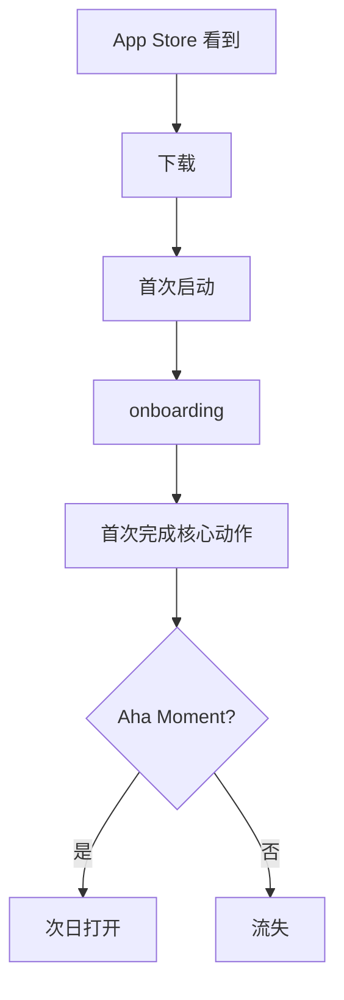

# {产品名} · PRD

**版本**: v1
**状态**: 草稿
**作者**: PRD 大师协作产出
**日期**: {YYYY-MM-DD}
**品类**: C 端移动 App

> 填写时沿用 `requirements.md` 的稳定 `Fnn / US-Fnn-nn / REQ-Fnn-nn / AC-Fnn-nn` 和已确认范围；历史 ID 不重编号。下方指标、角色和阶段仅为结构示例，不是已确认事实或默认任务；无量化证据时写已确认的可观察结果或验证计划，不为填表新增提问或研究。

---

## 0. 阶段路线图与 MVP 定义

> 放在 PRD 最前面，说明本次交付做什么、做完用户拿到什么及如何验收。沿用已确认的实际阶段和 `requirements.md` 的 `scope`；只有已选择 MVP 时才填写 MVP 定义，不默认三阶段或后置任何已确认功能。

| 阶段 | 已确认目标 | 功能模块 | 交付物（做完用户拿到什么） |
| :--- | :--- | :--- | :--- |
| {实际阶段名} | {本阶段要达成的结果；仅在确有假设时写验证目标} | {对应功能 ID} | {用户可完成的完整行为} |

> **本次范围与完成定义**：{当前 scope、对应功能 ID、各端/渠道/接口边界与已确认验收条件}。如有其他已确定阶段，在上表追加；没有则不补造路线图。

---

## 1. 项目背景与收益

### 1.1 需求简介

### 1.2 收益预估

#### 用户收益

- {已确认目标用户的实际痛点及改善后的可观察结果}
- {有量化依据时写影响人数、体验改进值及来源；没有则保留证据缺口}

#### 业务收益

- {已确认的业务目标或验证计划；DAU、MAU、留存等按场景选用，不预设数值或时间窗}
- {相关指标的实际基线、目标、时间窗与来源；没有量化依据时用已确认的可观察结果}
- 营收路径（如适用）：{已确认的广告 / 订阅 / 内购 / 电商等实际方式}

#### 不做风险

---

## 2. 用户画像

### 2.1 用户分层

| 角色 | 画像 | 渠道 | 高频场景 | 占比 |
|------|------|------|---------|------|
| {真实业务角色或用户群} | {已知画像} | {已确认渠道} | {实际场景} | {有依据的占比；未知则标明} |

### 2.2 明确不是谁

### 2.3 用户故事

- **US-F01-01**: 作为 {角色}, 我希望 {动作}, 以便 {价值}
- **US-F01-02**: ...

每个 US 关联本 PRD 已定义的功能，保留功能清单的 `实现 US` 映射；规则细则引用放在所属功能说明中。

---

## 3. 功能需求

### 3.1 功能清单

| ID | 功能 | 所属阶段 | 优先级 | 一句话 | 实现 US |
|----|------|---------|--------|--------|--------|

### 3.2 详细功能说明

#### 3.2.1 {功能 A}（F01）

**位置**：{Tab → 子模块 → 入口}
**目标**：

**业务过程与结果**：{必要输入、用户操作、系统反馈和后续状态；保留理解功能所需的关键界面信息}

**关键边界与失败结果**：{影响用户判断或产品取舍的权限、限制和异常结果}

**规则细则**：{引用 `requirements.md` 中对应 REQ/AC；必要摘要留在上文，不逐条重抄条件和规则}

**移动端专项**：
- 手势：...
- 横竖屏：...
- 不同尺寸适配（iPhone SE / 标准 / Pro Max / 折叠屏）：...
- 性能：首屏加载 < {ms}
- 离线行为：...
- 推送权限引导：...

---

## 4. 流程图

### 4.1 核心用户旅程

---

## 5. 边界与异常

### 5.1 弱网/无网

### 5.2 权限与隐私

- 相机/相册/位置/通讯录权限申请：何时申请、不给怎么办
- 用户隐私政策：...

### 5.3 平台合规

- AppStore 审核风险点：...
- 安卓应用市场审核：...
- 未成年保护：...

---

## 6. 成功度量

### 6.1 北极星指标

| 指标 | 基线 | 目标 | 时间窗 | 来源 |
|------|------|------|--------|------|
| {与当前目标一致的指标或可观察结果} | {实测值或未知} | {已确认目标} | {实际时间窗} | {可追溯来源} |

### 6.2 关键指标

| 指标 | 类型 | 基线 | 目标 | 时间窗 | 来源 |
|------|------|------|------|--------|------|
| 次日留存（如适用） | 用户 | {实测值或未知} | {已确认目标或验证计划} | {实际时间窗} | {可追溯来源} |
| 7 日留存（如适用） | 用户 | {实测值或未知} | {已确认目标或验证计划} | {实际时间窗} | {可追溯来源} |
| DAU/MAU（如适用） | 用户 | {实测值或未知} | {已确认目标或验证计划} | {实际时间窗} | {可追溯来源} |
| 注册转化（如适用） | 用户 | {实测值或未知} | {已确认目标或验证计划} | {实际时间窗} | {可追溯来源} |
| 平均使用时长（如适用） | 用户 | {实测值或未知} | {已确认目标或验证计划} | {实际时间窗} | {可追溯来源} |
| 付费转化（如适用） | 业务 | {实测值或未知} | {已确认目标或验证计划} | {实际时间窗} | {可追溯来源} |
| AppStore 评分（如适用） | 业务 | {实测值或未知} | {已确认目标或验证计划} | {实际时间窗} | {可追溯来源} |

---

## 7. 风险与依赖

---

## 8. 验收标准（5 维）

汇总各维度的关键产品结果并引用对应 AC，不逐条重抄 `requirements.md` 的验收细则。

### 8.1 主流程
### 8.2 异常
### 8.3 设备/系统兼容
### 8.4 网络场景
### 8.5 不变行为

---

## 9. 依据清单

---

## 10. 附录

### 10.1 推送策略

| 推送类型 | 触发条件 | 文案 | 频次上限 |
|---------|---------|------|---------|

### 10.2 ASO 关键词候选

| 关键词 | 搜索量 | 竞争度 | 我们排名预期 |
|--------|--------|--------|-------------|

### 10.3 关联资料
- 设计稿
- 假设清单
- 调研

### 10.4 关键决策

> 只列同时满足「有真实替代方案、已由负责人确认、推翻会改变核心边界/架构或造成明显返工」的决定。普通选择留在对应章节，完整讨论见 debate-log.md。

| 类型 | 决策 | 未选方案 | 为什么 | 主要代价 |
|------|------|---------|--------|---------|
| 产品/架构 | ... | ... | ... | ... |

---

## 11. 一致性自检
