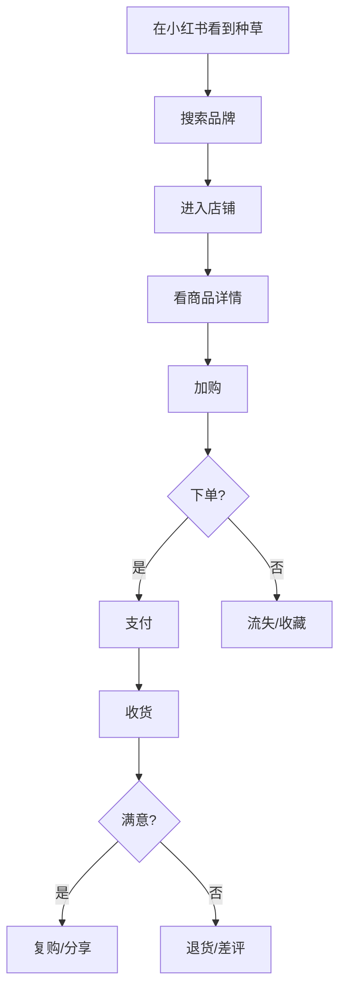

# {产品/项目名} · PRD

**版本**: v1
**状态**: 草稿
**日期**: {YYYY-MM-DD}
**品类**: C 端电商

> 填写时沿用 `requirements.md` 的稳定 `Fnn / US-Fnn-nn / REQ-Fnn-nn / AC-Fnn-nn` 和已确认范围；历史 ID 不重编号。下方指标、角色和阶段仅为结构示例，不是已确认事实或默认任务；无量化证据时写已确认的可观察结果或验证计划，不为填表新增提问或研究。

---

## 0. 阶段路线图与 MVP 定义

> 放在 PRD 最前面，说明本次交付做什么、做完用户拿到什么及如何验收。沿用已确认的实际阶段和 `requirements.md` 的 `scope`；只有已选择 MVP 时才填写 MVP 定义，不默认三阶段或后置任何已确认功能。

| 阶段 | 已确认目标 | 功能模块 | 交付物（做完用户拿到什么） |
| :--- | :--- | :--- | :--- |
| {实际阶段名} | {本阶段要达成的结果；仅在确有假设时写验证目标} | {对应功能 ID} | {用户可完成的完整行为} |

> **本次范围与完成定义**：{当前 scope、对应功能 ID、各端/渠道/接口边界与已确认验收条件}。如有其他已确定阶段，在上表追加；没有则不补造路线图。

---

## 1. 项目背景与收益

### 1.1 需求简介

### 1.2 收益预估

#### 用户收益
- {解决了用户购物中什么痛点}

#### 业务收益
- {已确认的业务目标或验证计划；GMV、客单价、复购率等按场景选用，不预设数值或时间窗}
- {相关指标的实际基线、目标、时间窗与来源；没有量化依据时用已确认的可观察结果}
- 流量来源（如适用）：{已确认的自然/付费/达人/直播等实际渠道；占比有依据时填写}

#### 不做风险

---

## 2. 用户画像

### 2.1 用户角色矩阵

| 角色 | 画像 | 客单价 | 复购周期 | 主要渠道 | 占比 |
|------|------|--------|---------|---------|------|

---

## 3. 功能/产品规划

### 3.1 SKU 规划

| SKU | 价格 | 主推卖点 | 目标毛利率 | 备货量 |
|-----|------|---------|----------|--------|

### 3.2 详情页规划

| 页面元素 | 内容要点 | 数据/证据支撑 |
|---------|---------|--------------|

### 3.3 用户故事

- **US-F01-01**: 作为 {用户角色}, 我希望 {购物体验}, 以便 {达成目标}

### 3.4 功能/能力清单（FR）

| ID | 能力 | 所属阶段 | 优先级 | 实现 US |
|----|------|---------|--------|---------|

保留 US 与本 PRD 已定义功能的映射。各功能说明写清用户过程、结果及关键边界、失败反馈，引用 `requirements.md` 对应 REQ/AC 的规则细则，不逐条重抄；必要摘要仍保留。

---

## 4. 用户购物旅程

---

## 5. 营销/获客策略

### 5.1 流量结构

| 渠道 | 占比目标 | 单次成本 | 转化率 | 备注 |
|------|---------|---------|--------|------|
| 自然搜索 | ... | - | ... | SEO |
| 付费投放 | ... | ... | ... | 千川/巨量 |
| 达人种草 | ... | ... | ... | 小红书/抖音 |
| 直播 | ... | ... | ... | 自播+达人 |
| 私域 | ... | - | ... | 企微/社群 |

### 5.2 内容种草矩阵

| 平台 | 内容形式 | 频次 | KPI |
|------|---------|------|-----|

### 5.3 大促策略

| 大促 | 主推 SKU | 折扣 | 备货量 | 流量加持 |
|------|---------|------|--------|---------|

---

## 6. 供应链与履约

### 6.1 供应链

- 自有 / OEM / 经销
- 备货周期
- 缺货补货机制

### 6.2 物流

- 仓储位置
- 物流合作方
- 时效承诺
- 异常处理（破损/丢件/延误）

### 6.3 售后

- 退换货政策
- 客服话术
- 投诉处理流程

---

## 7. 成功度量

| 指标 | 基线 | 目标 | 时间窗 | 来源 |
|------|------|------|--------|------|
| GMV（如适用） | {实测值或未知} | {已确认目标或验证计划} | {实际时间窗} | {可追溯来源} |
| 客单价 AOV（如适用） | {实测值或未知} | {已确认目标或验证计划} | {实际时间窗} | {可追溯来源} |
| 转化率（如适用） | {实测值或未知} | {已确认目标或验证计划} | {实际时间窗} | {可追溯来源} |
| 复购率（如适用） | {实测值或未知} | {已确认目标或验证计划} | {实际时间窗} | {可追溯来源} |
| 退货率（如适用） | {实测值或未知} | {已确认目标或验证计划} | {实际时间窗} | {可追溯来源} |
| ROAS（如适用） | {实测值或未知} | {已确认目标或验证计划} | {实际时间窗} | {可追溯来源} |

---

## 8. 风险与依赖

### 8.1 平台风险
- 平台规则变化
- 抽佣变化
- 流量算法调整

### 8.2 供应链风险
- 缺货
- 质量波动
- 物流中断

### 8.3 合规
- 食品/药品/化妆品资质
- 广告法（绝对化用语）
- 数据隐私

---

## 9. 验收标准

汇总各维度的关键产品结果并引用对应 AC，不逐条重抄 `requirements.md` 的验收细则。

### 9.1 主流程（下单到收货）
### 9.2 异常（退货/投诉/客服）
### 9.3 大促容量与用户可观察表现
### 9.4 合规审核
### 9.5 不变行为

---

## 10. 依据清单

---

## 11. 附录

### 11.1 关键决策

> 只列同时满足「有真实替代方案、已由负责人确认、推翻会改变核心边界/架构或造成明显返工」的决定。普通选择留在对应章节，完整讨论见 debate-log.md。

| 类型 | 决策 | 未选方案 | 为什么 | 主要代价 |
|------|------|---------|--------|---------|
| 产品/架构 | ... | ... | ... | ... |

---

## 12. 一致性自检
