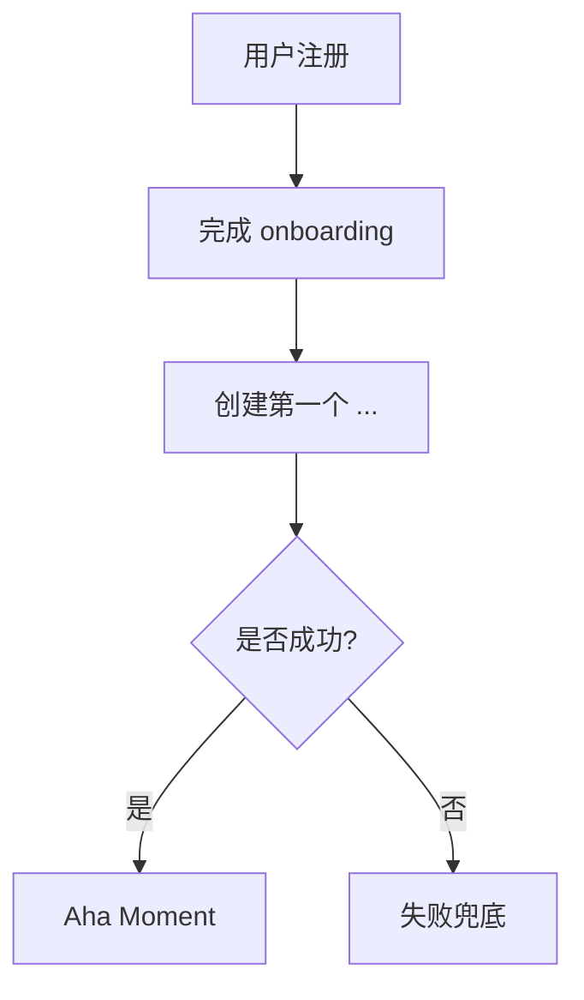
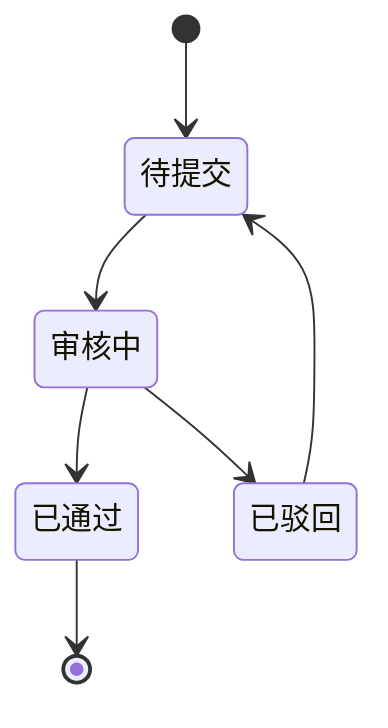

# {产品名} · PRD

**版本**: v1
**状态**: 草稿
**作者**: PRD 大师协作产出
**日期**: {YYYY-MM-DD}
**品类**: B 端 SaaS

> 填写时沿用 `requirements.md` 的稳定 `Fnn / US-Fnn-nn / REQ-Fnn-nn / AC-Fnn-nn` 和已确认范围；历史 ID 不重编号。下方指标、角色和阶段仅为结构示例，不是已确认事实或默认任务；无量化证据时写已确认的可观察结果或验证计划，不为填表新增提问或研究。

---

## 0. 阶段路线图与 MVP 定义

> 放在 PRD 最前面，说明本次交付做什么、做完用户拿到什么及如何验收。沿用已确认的实际阶段和 `requirements.md` 的 `scope`；只有已选择 MVP 时才填写 MVP 定义，不默认三阶段或后置任何已确认功能。

| 阶段 | 已确认目标 | 功能模块 | 交付物（做完用户拿到什么） |
| :--- | :--- | :--- | :--- |
| {实际阶段名} | {本阶段要达成的结果；仅在确有假设时写验证目标} | {对应功能 ID} | {用户可完成的完整行为} |

> **本次范围与完成定义**：{当前 scope、对应功能 ID、各端/渠道/接口边界与已确认验收条件}。如有其他已确定阶段，在上表追加；没有则不补造路线图。

---

## 1. 项目背景与收益

### 1.1 需求简介（一句话）

{为什么做、做什么、期望效果}

### 1.2 收益预估

#### 用户收益

- {已确认的用户可观察结果；有量化依据时写基线、目标及实际时间窗} —— 依据：{A/B/C/D/E 等级} —— 来源：{...}
- ...

#### 业务收益

- {已确认的业务目标或验证计划；ARR、MRR 增长、客户数等仅在适用且有依据时填写}
- {相关指标的实际基线、目标和时间窗；未知则明确缺口，不默认基线为 0}
- 依据：{...}

#### 不做风险

- {有依据的不做后果；有量化依据时再量化}

---

## 2. 用户画像

### 2.1 角色与权限矩阵（B 端必须）

| 角色 | 典型职位 | 公司规模 | 行业 | 决策权 | 使用频次 | 关键场景 |
|------|---------|---------|------|--------|---------|---------|
| {真实业务角色} | {实际职位，如适用} | {已知规模} | {实际行业} | {已确认权限} | {实际频次或未知} | {已有材料中的场景} |

### 2.2 明确不是谁

- ❌ {排除角色 1，理由}
- ❌ {排除场景 1，理由}

### 2.3 用户故事

- **US-F01-01**: 作为 {角色}, 我希望 {动作}, 以便 {价值}
- **US-F01-02**: ...

每个 US 沿用 `requirements.md` 的稳定 ID，并关联本 PRD 已定义的功能；保留功能清单的 `实现 US` 映射，规则细则引用放在所属功能说明中，不另建编号。

---

## 3. 功能需求

### 3.1 功能清单

| ID | 功能 | 所属阶段 | 优先级 | 一句话说明 | 实现 US |
|----|------|---------|--------|----------|---------|
| F01 | ... | {实际所属阶段} | {已确认优先级} | ... | US-F01-01 |

（用"必做/应做/可做"代替 P0/P1/P2）

### 3.2 详细功能说明（共享层）

#### 3.2.1 通用约定

- 时区：...
- 时间格式：...
- 国际化：...
- 数据权限模型：...（行级别 / 字段级别 / 数据隔离）

### 3.3 详细功能说明（模块层）

#### 3.3.1 {功能 A}（F01）

**位置**：{入口路径}
**目标**：{核心业务目标，一句话}

**业务过程与结果**：{必要输入、用户操作、系统反馈和后续状态；保留理解功能所需的关键界面信息}

**关键边界与失败结果**：{影响用户判断或产品取舍的权限、限制和异常结果}

**规则细则**：{引用 `requirements.md` 中对应 REQ/AC；必要摘要留在上文，不逐条重抄条件和规则}

---

## 4. 流程与状态图表

### 4.1 核心用户旅程（Mermaid）



### 4.2 关键状态机（如有）



---

## 5. 边界与异常场景

### 5.1 数据边界

- 空数据：...
- 超大数据：...
- 异常数据：...

### 5.2 并发与冲突

- 同一资源多人编辑：...
- 异步操作冲突：...

### 5.3 第三方依赖失败

- {依赖服务 A} 挂了：降级方案
- ...

---

## 6. 成功度量

### 6.1 北极星指标

| 指标 / 可观察结果 | 当前基线 | 已确认目标 | 时间窗（如适用） | 来源 |
|------|---------|---------|----------|------|
| {与当前业务目标一致的指标或结果} | {实测值或未知} | {已确认目标} | {实际时间窗} | {可追溯来源} |

### 6.2 关键指标矩阵

| 指标 | 类型 | 基线 | 目标 | 时间窗 | 数据来源 |
|------|------|------|------|--------|---------|
| 注册到激活转化（如适用） | 用户 | {实测值或未知} | {已确认目标或验证计划} | {实际时间窗} | {可追溯来源} |
| 月流失率（如适用） | 业务 | {实测值或未知} | {已确认目标或验证计划} | {实际时间窗} | {可追溯来源} |
| MRR（如适用） | 业务 | {实测值或未知} | {已确认目标或验证计划} | {实际时间窗} | {可追溯来源} |
| NDR（如适用） | 业务 | {实测值或未知} | {已确认目标或验证计划} | {实际时间窗} | {可追溯来源} |
| NPS（如适用） | 用户 | {实测值或未知} | {已确认目标或验证计划} | {实际时间窗} | {可追溯来源} |

已有量化指标写明基线、目标、时间窗和来源；尚无量化证据时沿用已确认的可观察结果或验证计划，明确缺口，不为填模板反推数字。

---

## 7. 风险与依赖

### 7.1 技术风险

- 风险 1：...（影响：高/中/低，缓解措施）
- ...

### 7.2 商业风险

- 风险 1：...

### 7.3 外部依赖

- 依赖 1：...（SLA、替代方案）
- ...

---

## 8. 验收标准（5 维必须覆盖）

汇总各维度的关键产品结果并引用对应 AC，不逐条重抄 `requirements.md` 的验收细则。

### 8.1 主流程

| 用户场景 | 前置条件 | 操作 | 产品可观察结果 |
|---------|---------|------|----------------|
| 注册并完成 onboarding | 全新用户 | ... | ... |

### 8.2 异常分支

| 场景 | 前置 | 操作 | 期望 |
|------|------|------|------|

### 8.3 权限与角色

| 场景 | 角色 | 操作 | 期望 |
|------|------|------|------|

### 8.4 兼容性

| 平台/浏览器 | 期望 |
|-----------|------|

### 8.5 不变行为

| 已有功能 | 本次变更后的预期保持 |
|---------|----------------------|

---

## 9. 依据清单

### 9.1 用户依据

- 依据 1：{访谈/调研/数据}（来源 + 链接）

### 9.2 竞品依据

- 仅引用实际使用的竞品依据；未做该项研究则省略，不要求生成 evidence/competitors.md

### 9.3 行业 Benchmark

- 仅引用实际使用的行业依据；没有则标明证据缺口或省略，不要求生成 evidence/benchmark.md

### 9.4 内部假设

- 见 assumptions.md（按假设影响的决定确定验证时点，阻塞当前判断的假设在该决定前处理）

---

## 10. 附录

### 10.1 术语表

| 术语 | 含义 |
|------|------|

### 10.2 关联资料

- 设计稿：...
- 调研记录：...
- 竞品分析：{仅实际存在且被引用时列出文件}
- 假设清单：assumptions.md
- 辩论记录：debate-log.md
- 业务确认来源：{引用已有场景或方案中的确认记录；对话存档仅在实际存在且需要时引用}

### 10.3 关键决策

> 只列同时满足「有真实替代方案、已由负责人确认、推翻会改变核心边界/架构或造成明显返工」的决定。普通选择留在对应章节，完整讨论见 debate-log.md。

| 类型 | 决策 | 未选方案 | 为什么 | 主要代价 |
|------|------|---------|--------|---------|
| 产品/架构 | ... | ... | ... | ... |

---

## 11. 一致性自检（自动生成，校验通过才算定稿）

由 `check_consistency.py` 实际运行后填入，不能照抄示例为通过结论：

```
Consistency check:
- User Stories → FR mapping:
  - {实际 US → F 映射与检查结果}
  - ...
- Business Goals → Metrics:
  - {实际业务目标 → 同口径指标及检查结果}
  - ...
- User Goals → Metrics:
  - ...
- Persona / Goal / US alignment: {实际结果}
```
